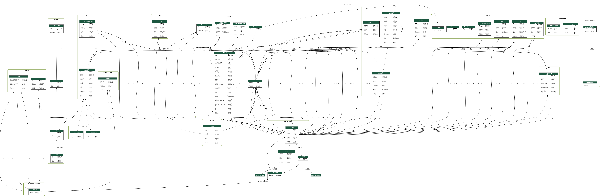

# **CommerceCore** Version 2.0

Django REST API backend for an ecommerce platform, with catalog, product, store, discount, blog, user, and location modules.

**Suggested project name: CommerceCore** — a name that reflects the shared backend for product management and retail operations. This is a naming suggestion; the existing Python package remains `ecommerce_core`.

## Project image



The image above is the repository's database entity relationship diagram, not a screenshot of a running application. Open [the full-size diagram](erd.png) to inspect the tables and relationships.

## Technology and scope

- Python, Django 3.2.6, and Django REST Framework 3.13.1.
- JWT authentication through Simple JWT and authentication configuration through dj-rest-auth.
- OpenAPI documentation through drf-spectacular.
- PostgreSQL/PostGIS configuration and a SQLite fallback.
- Celery configuration with RabbitMQ and Redis environment settings.
- Point-of-sale models are present, but their API route is commented out in the root URL configuration.

## Execution report

Run attempted on **November 26, 2026**, using **Python 3.9.25** on Linux.

**Result: application startup blocked. No running UI or successful API response was verified.**

| Check                                                                        | Result                                                                                                    |
| ---------------------------------------------------------------------------- | --------------------------------------------------------------------------------------------------------- |
| Initial `python manage.py check`                                           | Failed because Django was absent from the active environment.                                             |
| Install `requirements.txt` in an isolated virtual environment              | Passed after network access was enabled. All declared dependencies installed.                             |
| Parse repository Python sources with `ast.parse`                           | Passed: 170 files, zero syntax errors. This does not validate imports or runtime behavior.                |
| `manage.py check` after installation, without an `.env`                  | Failed with `UndefinedValueError: SECRET_KEY not found`.                                                |
| `manage.py check` with temporary local environment placeholders            | Failed during GeoDjango initialization: GDAL library not found.                                           |
| `manage.py test` with the same placeholders                                | Blocked by the same GDAL error before tests could run. The checked-in test files contain no test methods. |
| `manage.py runserver 127.0.0.1:8000 --noreload` with the same placeholders | Exited with status 1 because GDAL was missing; no server started.                                         |

The isolated environment was created at `/tmp/ecommerce-readme-venv`. Placeholder values were supplied only to diagnostic subprocesses; no real service credentials or remote database were used. Migrations and database operations were not performed.

Representative startup error:

```text
django.core.exceptions.ImproperlyConfigured: Could not find the GDAL library
```

### Setup gaps found during inspection

1. `django.contrib.gis` requires native GIS libraries, including GDAL. Installing Python requirements alone does not supply these system libraries.
2. `.env.example` omits required settings: `DATABASE_URL`, `NGORK_URL`, `METABASE_SITE_URL`, and `METABASE_SECRET_KEY`. These are read without defaults.
3. `DATABASE_URL` is used as a switch, not parsed as a connection string. A nonempty value selects PostGIS using the separate `DB_*` variables; an empty value selects SQLite. The `DB_*` variables are still read in both cases.
4. `dj_rest_auth.registration` is enabled, but `django-allauth` is not listed in `requirements.txt`. Its dependency and app configuration need review after the GIS blocker is resolved.
5. Request helper modules import `requests`, which is not explicitly declared in `requirements.txt`.
6. The example environment contains credential-like values. Replace them with your own local configuration rather than using the supplied values.

Items 2–6 were found by inspecting the source; they are not evidence of successful startup beyond the GDAL failure.

## Local setup

The following is the intended setup sequence. It remains unverified end to end because of the blockers above.

```bash
python3.9 -m venv .venv
source .venv/bin/activate
python -m pip install -r requirements.txt
cp .env.example .env
```

Install the native GeoDjango dependencies for your operating system. For the PostGIS database path, prepare a local PostgreSQL database with the PostGIS extension.

Edit `.env` with your own local values. In addition to the existing keys, add:

```dotenv
# Empty selects SQLite; a nonempty value selects the DB_* PostGIS connection.
DATABASE_URL=
NGORK_URL=
METABASE_SITE_URL=
METABASE_SECRET_KEY=
```

Set `SECRET_KEY` to a newly generated local secret. Supply every setting read without a default in `ecommerce_core/settings/app_vars.py` and `base.py`. Review the missing authentication and request dependencies described above before continuing.

Once those prerequisites are resolved:

```bash
python manage.py check
python manage.py migrate
python manage.py createsuperuser
python manage.py test
python manage.py runserver 127.0.0.1:8000
```

## Configured routes

These routes are defined in the source and were **not verified over HTTP** during this run.

| Path                     | Purpose                     |
| ------------------------ | --------------------------- |
| `/`                    | Swagger UI                  |
| `/redoc/`              | ReDoc documentation         |
| `/spectacular/`        | OpenAPI schema              |
| `/health_check/`       | Service health response     |
| `/admin/`              | Django administration       |
| `/api-auth/`           | REST Framework login/logout |
| `/api/v2.0/users/`     | User APIs                   |
| `/api/v2.0/catalog/`   | Catalog APIs                |
| `/api/v2.0/products/`  | Product APIs                |
| `/api/v2.0/store/`     | Store APIs                  |
| `/api/v2.0/discount/`  | Discount APIs               |
| `/api/v2.0/blogs/`     | Blog APIs                   |
| `/api/v2.0/locations/` | Location APIs               |

After successful startup, open `http://127.0.0.1:8000/` for documentation or check the health endpoint:

```bash
curl -i http://127.0.0.1:8000/health_check/
```

## Export data

After database setup, export all data or a selected app:

```bash
python manage.py dumpdata > dataset.json
python manage.py dumpdata products > products.json
```
